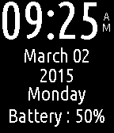

<!-- Generated by scripts/update_app_directory.py: do not edit by hand -->
[← All Pebble Developers](../developers.md)

# Shivanshu Goyal

*1 watchface · Last updated 2026-10-11 · [About these lists](../about-app-lists.md)*

Links: [Pebble App Store](https://apps.repebble.com/apps/dev/shivanshu-goyal_53b4d432ee5a60da4c000138) · [GitHub (shivanshu3)](https://github.com/shivanshu3)

<h2 class="app-name" id="app-54f55168e8b907f688000017"><a href="https://apps.repebble.com/54f55168e8b907f688000017">Essentials</a> v1.0</h2>
<a class="app-source" href="https://github.com/shivanshu3/PebbleEssentials" title="Source code" data-search-exclude>View source</a>

Watchface

Released 2015-03-03 Updated 2015-03-03

Runs on: Time 2, Pebble 2 Duo, Pebble 2, Time, Classic

A simple watch face that shows time and your Pebble&#x27;s battery level without any distractions.

