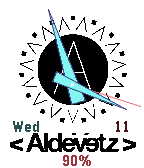

<!-- Generated by scripts/update_app_directory.py: do not edit by hand -->
[← All Pebble Developers](../developers.md)

# shizuku kun

*1 watchface · Last updated 2026-10-12 · [About these lists](../about-app-lists.md)*

Links: [Pebble App Store](https://apps.repebble.com/apps/dev/shizuku-kun_55b5831f5e07167c5f000007) · [GitHub (shizukukun)](https://github.com/shizukukun) · [Website (aldevetz.com)](http://aldevetz.com/)

<h2 class="app-name" id="app-5642ae311c68dcdba900000e"><a href="https://apps.repebble.com/5642ae311c68dcdba900000e">Aldevetz Watchface</a> v1.3</h2>
<a class="app-source" href="https://github.com/shizukukun/aldevetzwatch" title="Source code" data-search-exclude>View source</a>

Watchface

Released 2015-11-11 Updated 2015-11-11

Runs on: Round 2, Time 2, Time Round, Time

J-Rock Band Aldevetz Watchface

