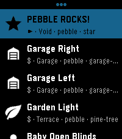
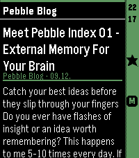

<!-- Generated by scripts/update_app_directory.py: do not edit by hand -->
[← All Pebble Developers](../developers.md)

# SHUred

*2 apps · Last updated 2026-10-11 · [About these lists](../about-app-lists.md)*

Links: [Pebble App Store](https://apps.repebble.com/apps/dev/shured_7b17544a2d79e1b12db305ca) · [GitHub (SHU-red)](https://github.com/SHU-red)

<button type="button" data-filter="all" aria-pressed="true">All 2</button><button type="button" data-filter="watchface" aria-pressed="false" disabled>Watchfaces 0</button><button type="button" data-filter="watchapp" aria-pressed="false">Apps 2</button>

<label class="dev-sort">Sort by <select><option value="updated">Recently updated</option><option value="released">Newest release</option><option value="title">A–Z</option></select></label>

<h2 class="app-name" id="app-870db6270e80447089753dd5"><a href="https://apps.repebble.com/870db6270e80447089753dd5">HA Launcher</a> v0.8.2</h2>
<a class="app-source" href="https://github.com/SHU-red/pebble-ha-launcher" title="Source code" data-search-exclude>View source</a>

App · <a href="https://forum.rebble.io/t/1234" title="Discuss this app on the Rebble forum" data-search-exclude>Forum thread</a>

No licence Released 2026-08-14 Updated 2026-10-02

Runs on: Round 2, Time 2, Pebble 2 Duo, Pebble 2, Time Round, Time

Stored shortcuts launch instantly — no browsing, no waiting. Setup is easy: the app fetches every available SCRIPT and SCENE from your HA automatically. Per-shortcut a confirmation checkpoint can…

<h2 class="app-name" id="app-a8ece66acd244751b96874a1"><a href="https://apps.repebble.com/a8ece66acd244751b96874a1">HeadeRSS</a> v0.3.45</h2>
<a class="app-source" href="https://github.com/SHU-red/pebble-headerss" title="Source code" data-search-exclude>View source</a>

App · <a href="https://forum.rebble.io/t/1237" title="Discuss this app on the Rebble forum" data-search-exclude>Forum thread</a>

No licence Released 2026-08-15 Updated 2026-08-29

Runs on: Round 2, Time 2, Pebble 2 Duo, Pebble 2, Time Round, Time

Pull feed headings and summaries from any Google Reader-compatible API, such as FreshRSS, and enjoy a lightweight reading experience on your Pebble. - Show all articles either at folder level or…

