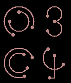

<!-- Generated by scripts/update_app_directory.py: do not edit by hand -->
[← All Pebble Developers](../developers.md)

# Si Te

*1 watchface · Last updated 2026-10-12 · [About these lists](../about-app-lists.md)*

Links: [Pebble App Store](https://apps.repebble.com/apps/dev/si-te_541a4e73a3c11b4d5c000089) · [GitHub (sitefeng)](https://github.com/sitefeng)

<h2 class="app-name" id="app-5508e6201a6b43fbeb00008f"><a href="https://apps.repebble.com/5508e6201a6b43fbeb00008f">ArcTime</a> v1.0</h2>
<a class="app-source" href="https://github.com/sitefeng/ArcTime" title="Source code" data-search-exclude>View source</a>

Watchface

Released 2015-03-18 Updated 2015-03-18

Runs on: Time 2, Pebble 2 Duo, Pebble 2, Time, Classic

ArcTime is an artistic watchface that uses only lines and dots to create intricate numbers. Made for Pebble Time and Pebble Time Steel.

