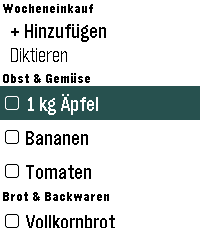

<!-- Generated by scripts/update_app_directory.py: do not edit by hand -->
[← All Pebble Developers](../developers.md)

# Si2Po

*1 app · Last updated 2026-11-23 · [About these lists](../about-app-lists.md)*

Links: [Pebble App Store](https://apps.repebble.com/apps/dev/si2po_60ef6482b76aea1bf2cdb804) · [GitHub (Si2Po)](https://github.com/Si2Po) · [Website (si2po.github.io)](https://si2po.github.io/einkaufsroute/)

<h2 class="app-name" id="app-ac30958bb7354ed089ade6d0"><a href="https://apps.repebble.com/ac30958bb7354ed089ade6d0">Einkaufsroute</a> v1.5.1</h2>
<a class="app-source" href="https://github.com/Si2Po/einkaufsroute-pebble" title="Source code" data-search-exclude>View source</a>

App

No licence Released 2026-11-16 Updated 2026-11-16

Runs on: Round 2, Time 2, Pebble 2 Duo, Pebble 2, Time Round, Time, Classic

Your shopping list, right on your wrist. This is the watch companion to Einkaufsroute (&quot;shopping route&quot;), a free shopping list app that sorts your list by category, in the order you walk through…

