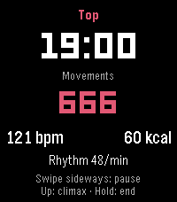
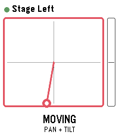
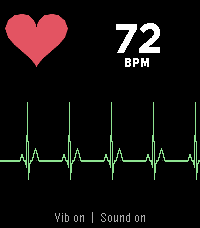

<!-- Generated by scripts/update_app_directory.py: do not edit by hand -->
[← All Pebble Developers](../developers.md)

# SIDEffect&\#x27;s

*3 apps · Last updated 2026-10-11 · [About these lists](../about-app-lists.md)*

Links: [Pebble App Store](https://apps.repebble.com/apps/dev/sideffect-s_a26181dcbfab8c2033428ca1) · [GitHub (n0va-SIDEffects)](https://github.com/n0va-SIDEffects)

<button type="button" data-filter="all" aria-pressed="true">All 3</button><button type="button" data-filter="watchface" aria-pressed="false" disabled>Watchfaces 0</button><button type="button" data-filter="watchapp" aria-pressed="false">Apps 3</button>

<label class="dev-sort">Sort by <select><option value="updated">Recently updated</option><option value="released">Newest release</option><option value="title">A–Z</option></select></label>

<h2 class="app-name" id="app-9bf1158041d44e60a531f166"><a href="https://apps.repebble.com/9bf1158041d44e60a531f166">Stamina</a> v0.6</h2>
<a class="app-source" href="https://github.com/n0va-SIDEffects/Pebble-Stamina" title="Source code" data-search-exclude>View source</a>

App

Released 2026-09-19 Updated 2026-09-19

Runs on: Time 2, Pebble 2 Duo, Pebble 2, Time

Stamina is a private wellness tracker for your intimate life, solo or with a partner. It measures rhythm, heart rate and estimated calories, and shows how a session affects your sleep and the…

<h2 class="app-name" id="app-4c2a4793dc5e4703862b901a"><a href="https://apps.repebble.com/4c2a4793dc5e4703862b901a">PTZ Remote</a> v0.9</h2>
<a class="app-source" href="https://github.com/n0va-SIDEffects/Pebble-Panasonic-PTZ-Kamera" title="Source code" data-search-exclude>View source</a>

App

Released 2026-09-17 Updated 2026-09-17

Runs on: Time 2, Pebble 2 Duo, Pebble 2, Time

Drive Panasonic PTZ cameras from your wrist - with the buttons or by tilting the watch. PTZ Remote controls Panasonic AW-series cameras through their HTTP interface. Your phone does the talking…

<h2 class="app-name" id="app-d2ffde338d504074a760cb88"><a href="https://apps.repebble.com/d2ffde338d504074a760cb88">Heart Rate FX</a> v1.0</h2>
<a class="app-source" href="https://github.com/n0va-SIDEffects/pebble-Heart-Rate-FX" title="Source code" data-search-exclude>View source</a>

App

Released 2026-09-17 Updated 2026-09-17

Runs on: Round 2, Time 2, Pebble 2 Duo, Pebble 2

Your pulse as a trace, a sound and a light. Heart Rate FX turns your watch into a bedside monitor. It reads the optical sensor and shows every beat three ways at once: a sweeping ECG-style trace…

