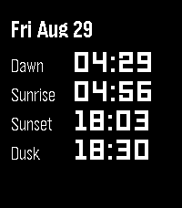

<!-- Generated by scripts/update_app_directory.py: do not edit by hand -->
[← All Pebble Developers](../developers.md)

# Sidpatchy

*1 app · Last updated 2026-10-11 · [About these lists](../about-app-lists.md)*

Links: [Pebble App Store](https://apps.repebble.com/apps/dev/sidpatchy_5dc866083b94d40001b3ca96) · [GitHub (Sidpatchy)](https://github.com/Sidpatchy) · [Website (sidpatchy.com)](https://www.sidpatchy.com/)

<h2 class="app-name" id="app-68b212c30d63e60009529624"><a href="https://apps.repebble.com/68b212c30d63e60009529624">Helios</a> v1.0</h2>
<a class="app-source" href="https://github.com/Sidpatchy/Helios" title="Source code" data-search-exclude>View source</a>

App

GPL-3.0 Released 2025-08-29 Updated 2025-08-29

Runs on: Round 2, Time 2, Pebble 2 Duo, Pebble 2, Time Round, Time, Classic

Helios puts the sun’s daily milestones on your wrist: Dawn, Sunrise, Sunset, and Dusk. Navigate forward and backwards in time with the up and down buttons, then return to present day with the…

