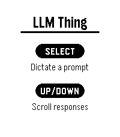

<!-- Generated by scripts/update_app_directory.py: do not edit by hand -->
[← All Pebble Developers](../developers.md)

# Silas

*1 app · Last updated 2026-11-09 · [About these lists](../about-app-lists.md)*

Links: [Pebble App Store](https://apps.repebble.com/apps/dev/silas_b2042e7e8872067658157faf) · [GitHub (SeeSharpSi)](https://github.com/SeeSharpSi)

<h2 class="app-name" id="app-b8319da1343f40b9a3000650"><a href="https://apps.repebble.com/b8319da1343f40b9a3000650">LLM Thing</a> v0.1.1</h2>
<a class="app-source" href="https://github.com/SeeSharpSi/llm_thing" title="Source code" data-search-exclude>View source</a>

App

No licence Released 2026-10-26 Updated 2026-10-26

Runs on: Round 2, Time 2, Pebble 2 Duo, Pebble 2, Time Round, Time

I way to give Pebble-related tools and dictation to an OpenAI compatible endpoint. Also supports MCP servers.

