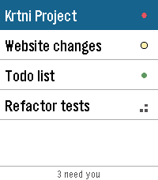
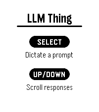

<!-- Generated by scripts/update_app_directory.py: do not edit by hand -->
[← All Pebble Developers](../developers.md)

# Silas

*2 apps · Last updated 2026-11-16 · [About these lists](../about-app-lists.md)*

Links: [Pebble App Store](https://apps.repebble.com/apps/dev/silas_b2042e7e8872067658157faf) · [GitHub (SeeSharpSi)](https://github.com/SeeSharpSi)

<button type="button" data-filter="all" aria-pressed="true">All 2</button><button type="button" data-filter="watchface" aria-pressed="false" disabled>Watchfaces 0</button><button type="button" data-filter="watchapp" aria-pressed="false">Apps 2</button>

<label class="dev-sort">Sort by <select><option value="updated">Recently updated</option><option value="released">Newest release</option><option value="title">A–Z</option></select></label>

<h2 class="app-name" id="app-7ef8eab732ef4c26a34a8fb7"><a href="https://apps.repebble.com/7ef8eab732ef4c26a34a8fb7">OpenCode Status</a> v1.7.4</h2>
<a class="app-source" href="https://github.com/SeeSharpSi/pebble-oc-status" title="Source code" data-search-exclude>View source</a>

App

No licence Released 2026-11-09 Updated 2026-11-15

Runs on: Round 2, Time 2, Pebble 2 Duo, Pebble 2, Time Round, Time, Classic

OpenCode Status puts your OpenCode sessions on your Pebble. See running sessions, questions, permission requests, and unread replies at a glance. Open a session to read its latest reply, answer…

<h2 class="app-name" id="app-b8319da1343f40b9a3000650"><a href="https://apps.repebble.com/b8319da1343f40b9a3000650">LLM Thing</a> v0.3.0</h2>
<a class="app-source" href="https://github.com/SeeSharpSi/llm_thing" title="Source code" data-search-exclude>View source</a>

App

No licence Released 2026-10-26 Updated 2026-11-09

Runs on: Round 2, Time 2, Pebble 2 Duo, Pebble 2, Time Round, Time

Dictate prompts on your Pebble and get answers from an OpenAI-compatible model. Supports web search, geolocation, Timeline, Health, memories, remote MCP tools, and Pebble plugin sources and…

