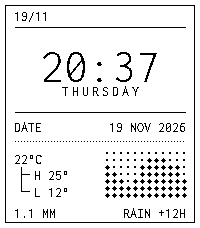

<!-- Generated by scripts/update_app_directory.py: do not edit by hand -->
[← All Pebble Developers](../developers.md)

# silkm

*1 watchface · Last updated 2026-11-23 · [About these lists](../about-app-lists.md)*

Links: [Pebble App Store](https://apps.repebble.com/apps/dev/silkm_06d7c931e1e59d771444b696) · [GitHub (silkm)](https://github.com/silkm)

<h2 class="app-name" id="app-1e9ec4f0b3994bc197a2ee4b"><a href="https://apps.repebble.com/1e9ec4f0b3994bc197a2ee4b">Label Face</a> v1.0.0</h2>
<a class="app-source" href="https://github.com/silkm/pebble-label-face" title="Source code" data-search-exclude>View source</a>

Watchface

MIT Released 2026-11-19 Updated 2026-11-19

Runs on: Time 2

A minimal Pebble watchface styled like a pharmacy or small-batch bottle label. At least, that&#x27;s the intention but for the life of me I can&#x27;t find a good example of what I&#x27;m picturing online!! Very…

