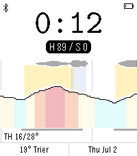

<!-- Generated by scripts/update_app_directory.py: do not edit by hand -->
[← All Pebble Developers](../developers.md)

# simmsb

*1 watchface · Last updated 2026-11-09 · [About these lists](../about-app-lists.md)*

Links: [Rebble App Store](https://apps.rebble.io/en_US/developer/6a2342097a54110009dbab17/1) · [GitHub (simmsb)](https://github.com/simmsb)

<h2 class="app-name" id="app-6adb9073fdccdc000901cae7"><a href="https://apps.rebble.io/en_US/application/6adb9073fdccdc000901cae7">pebble-weather-graph</a> v1.0.0</h2>
<a class="app-source" href="https://github.com/simmsb/pebble-weather-graph/" title="Source code" data-search-exclude>View source</a>

Watchface

No licence Released 2026-10-23 Updated 2026-10-23 Rebble App Store

Runs on: Time 2

Shows the weather as a graph

