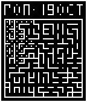

<!-- Generated by scripts/update_app_directory.py: do not edit by hand -->
[← All Pebble Developers](../developers.md)

# Simon Jackson

*1 watchface and 1 app · Last updated 2026-10-12 · [About these lists](../about-app-lists.md)*

Links: [Pebble App Store](https://apps.repebble.com/apps/dev/simon-jackson_53b089fdb9bff86310000009) · [GitHub (jackokring)](https://github.com/jackokring) · [Website (jackokring.github.io)](http://jackokring.github.io/pebble-sdk-examples/)

<button type="button" data-filter="all" aria-pressed="true">All 2</button><button type="button" data-filter="watchface" aria-pressed="false">Watchfaces 1</button><button type="button" data-filter="watchapp" aria-pressed="false">Apps 1</button>

<label class="dev-sort">Sort by <select><option value="updated">Recently updated</option><option value="released">Newest release</option><option value="title">A–Z</option></select></label>

<h2 class="app-name" id="app-5539019ca893513ec2000081"><a href="https://apps.repebble.com/5539019ca893513ec2000081">Log Clock</a> v2.4</h2>
<a class="app-source" href="https://github.com/jackokring/pebble-sdk-examples/tree/master/watchfaces/log_clock" title="Source code" data-search-exclude>View source</a>

Watchface

No licence Released 2015-04-23 Updated 2015-10-21

Runs on: Time 2, Pebble 2 Duo, Pebble 2, Time, Classic

Displays: 1. Location (also infers BT connectivity) 2. Reverse tan and exp gradients both div 10 3. Current X (charge+)Battery 4. Arc tan 1 @ 45 degree = 1 and gradient div 10 5. Log10 and…

<h2 class="app-name" id="app-5544a7bbe62871ef6d000038"><a href="https://apps.repebble.com/5544a7bbe62871ef6d000038">RoboMaze</a> v2.7</h2>
<a class="app-source" href="https://github.com/jackokring/pebble-sdk-examples/tree/master/watchapps/RoboMaze" title="Source code" data-search-exclude>View source</a>

App

No licence Released 2015-05-02 Updated 2015-10-17

Runs on: Time 2, Pebble 2 Duo, Pebble 2, Time, Classic

A simple game and watch face dual use app. The BACK button is mode select. Use long press BACK to exit. Features (Watch): Clock, Date, Stopwatch (959:59:59 seconds loop. Think old style 1st/2nd…

