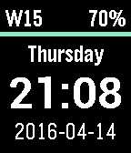

<!-- Generated by scripts/update_app_directory.py: do not edit by hand -->
[← All Pebble Developers](../developers.md)

# simon

*1 watchface · Last updated 2026-10-12 · [About these lists](../about-app-lists.md)*

Links: [Pebble App Store](https://apps.repebble.com/apps/dev/simon_52bc8ee9530bf47e36000174) · [GitHub (simonra)](https://github.com/simonra)

<h2 class="app-name" id="app-570fee9de66231da72000020"><a href="https://apps.repebble.com/570fee9de66231da72000020">Essentials</a> v1.2</h2>
<a class="app-source" href="https://github.com/simonra/pebble-watchface-essentials" title="Source code" data-search-exclude>View source</a>

Watchface

Released 2016-04-14 Updated 2016-07-13

Runs on: Round 2, Time 2, Pebble 2 Duo, Pebble 2, Time Round, Time, Classic

A watch face showing the time (24H style), the weekday (full English), the current date (ISO8601, yyyy-mm-dd), the current week (ISO 8601 due to that being the standard in Norway), and the battery…

