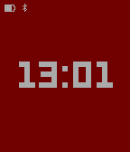

<!-- Generated by scripts/update_app_directory.py: do not edit by hand -->
[← All Pebble Developers](../developers.md)

# simpoir

*1 watchface · Last updated 2026-10-11 · [About these lists](../about-app-lists.md)*

Links: [Pebble App Store](https://apps.repebble.com/apps/dev/simpoir_55a8042a31553f9fac00004f) · [GitHub (simpoir)](https://github.com/simpoir)

<h2 class="app-name" id="app-55bf8c7506d956b72300004a"><a href="https://apps.repebble.com/55bf8c7506d956b72300004a">Colorcycle</a> v1.1</h2>
<a class="app-source" href="https://github.com/simpoir/pebble-chromacyle" title="Source code" data-search-exclude>View source</a>

Watchface

Released 2015-08-03 Updated 2015-08-14

Runs on: Time 2, Time

Will cycle the hue of the background during the hour, slowly as to not distract but enough so that you can notice the change once in a while.

