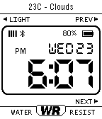

<!-- Generated by scripts/update_app_directory.py: do not edit by hand -->
[← All Pebble Developers](../developers.md)

# singleserveapps

*1 watchface · Last updated 2026-10-12 · [About these lists](../about-app-lists.md)*

Links: [Rebble App Store](https://apps.rebble.io/en_US/developer/542eeb101df24a56960001bd/1) · [GitHub (singleserveapps)](https://github.com/singleserveapps)

<h2 class="app-name" id="app-56f2f298065dfd86a800000c"><a href="https://apps.rebble.io/en_US/application/56f2f298065dfd86a800000c">91 Dub Weather</a> v1.5</h2>
<a class="app-source" href="https://github.com/singleserveapps/91-Dub-v2.0" title="Source code" data-search-exclude>View source</a>

Watchface

Released 2016-03-23 Updated 2016-10-14 Rebble App Store

Runs on: Time 2, Pebble 2 Duo, Pebble 2, Time, Classic

A version of 91 Dub (originally by orviwan) with added weather information. - Select how often OpenWeatherMap.org weather information is updated - Retrieve weather information using GPS or by…

