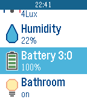

<!-- Generated by scripts/update_app_directory.py: do not edit by hand -->
[← All Pebble Developers](../developers.md)

# sionyx

*1 app · Last updated 2026-10-12 · [About these lists](../about-app-lists.md)*

Links: [Pebble App Store](https://apps.repebble.com/apps/dev/sionyx_55f7e56e913b98cdf200004f) · [GitHub (sionyx)](https://github.com/sionyx)

<h2 class="app-name" id="app-564cdd04435b21d2ec000020"><a href="https://apps.repebble.com/564cdd04435b21d2ec000020">ZWay Time</a> v1.3</h2>
<a class="app-source" href="https://github.com/sionyx/pebble_zway_time" title="Source code" data-search-exclude>View source</a>

App

Released 2015-11-18 Updated 2016-01-28

Runs on: Time 2, Pebble 2 Duo, Pebble 2, Time, Classic

ZWay Time application allows you to control your RaZberry based smart home. It supports controls: - on-off switches; - dimmers; - RGB switches; and sensors: - motion; - humidity; - light; …

