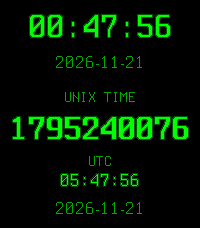
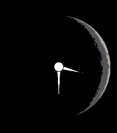
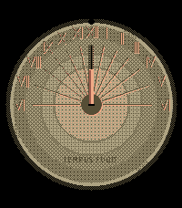
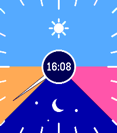
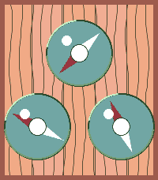

<!-- Generated by scripts/update_app_directory.py: do not edit by hand -->
[← All Pebble Developers](../developers.md)

# Sitwon

*5 watchfaces · Last updated 2026-11-23 · [About these lists](../about-app-lists.md)*

Links: [Pebble App Store](https://apps.repebble.com/apps/dev/sitwon_39bed3062aa58b3ec9601265) · [GitHub (Sitwon)](https://github.com/Sitwon)

<button type="button" data-filter="all" aria-pressed="true">All 5</button><button type="button" data-filter="watchface" aria-pressed="false">Watchfaces 5</button><button type="button" data-filter="watchapp" aria-pressed="false" disabled>Apps 0</button>

<label class="dev-sort">Sort by <select><option value="updated">Recently updated</option><option value="released">Newest release</option><option value="title">A–Z</option></select></label>

<h2 class="app-name" id="app-7d02599fd19f46c383db4751"><a href="https://apps.repebble.com/7d02599fd19f46c383db4751">Server Time</a> v1.1.0</h2>
<a class="app-source" href="https://github.com/Sitwon/pebble-server-time" title="Source code" data-search-exclude>View source</a>

Watchface

MIT Released 2026-11-21 Updated 2026-11-21

Runs on: Round 2, Time 2

Phosphor-terminal watchface: local time and date with seconds, live Unix epoch counter, and UTC time and date, all in a true monospace terminal font on a black screen.

<h2 class="app-name" id="app-c9b04db0ce7341a89a19f812"><a href="https://apps.repebble.com/c9b04db0ce7341a89a19f812">Moon</a> v1.0.0</h2>
<a class="app-source" href="https://github.com/Sitwon/pebble-moon" title="Source code" data-search-exclude>View source</a>

Watchface

MIT Released 2026-11-21 Updated 2026-11-21

Runs on: Round 2, Time 2, Time Round, Time

A photo-real moon at its current phase, rendered from NASA&#x27;s Lunar Reconnaissance Orbiter imagery - the terminator and crater shadows at the day line are real. Optional analog clock hands (toggle…

<h2 class="app-name" id="app-a0f880336bcf4bcfa4f1acb8"><a href="https://apps.repebble.com/a0f880336bcf4bcfa4f1acb8">Sundial</a> v1.0.1</h2>
<a class="app-source" href="https://github.com/Sitwon/pebble-sundial" title="Source code" data-search-exclude>View source</a>

Watchface

MIT Released 2026-11-20 Updated 2026-11-20

Runs on: Round 2, Time 2

Sundial shows apparent solar time on a simulated horizontal brass dial: the shadow of the gnomon falls on the correct hour line for your location and the real solar position. Apparent (sundial)…

<h2 class="app-name" id="app-cf36b2225f634b2393b37886"><a href="https://apps.repebble.com/cf36b2225f634b2393b37886">Palia Time</a> v1.1.1</h2>
<a class="app-source" href="https://github.com/Sitwon/pebble-palia-watchface" title="Source code" data-search-exclude>View source</a>

Watchface

No licence Released 2026-11-15 Updated 2026-11-20

Runs on: Round 2, Time 2, Time Round, Time

See Palia&#x27;s in-game time at a glance. A one-hand 24-hour dial colored like the in-game clock — dawn, day, dusk, and night sectors sweep the full screen, with a sun at noon, a crescent moon and…

<h2 class="app-name" id="app-2ac4f9ce9225439a882b457d"><a href="https://apps.repebble.com/2ac4f9ce9225439a882b457d">One Piece Log Pose</a> v1.1.2</h2>
<a class="app-source" href="https://github.com/Sitwon/pebble-onepiece-logpose-face" title="Source code" data-search-exclude>View source</a>

Watchface

No licence Released 2026-11-15 Updated 2026-11-16

Runs on: Round 2, Time 2

A New World Log Pose watch face for the Pebble Time 2 (emery) and Pebble Round 2 (gabbro), inspired by One Piece. The whole screen is the log pose: a wooden base with three glass orbs — the top…

