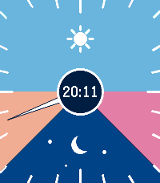

<!-- Generated by scripts/update_app_directory.py: do not edit by hand -->
[← All Pebble Developers](../developers.md)

# Sitwon

*2 watchfaces · Last updated 2026-11-16 · [About these lists](../about-app-lists.md)*

Links: [Pebble App Store](https://apps.repebble.com/apps/dev/sitwon_39bed3062aa58b3ec9601265) · [GitHub (Sitwon)](https://github.com/Sitwon)

<button type="button" data-filter="all" aria-pressed="true">All 2</button><button type="button" data-filter="watchface" aria-pressed="false">Watchfaces 2</button><button type="button" data-filter="watchapp" aria-pressed="false" disabled>Apps 0</button>

<label class="dev-sort">Sort by <select><option value="updated">Recently updated</option><option value="released">Newest release</option><option value="title">A–Z</option></select></label>

<h2 class="app-name" id="app-2ac4f9ce9225439a882b457d"><a href="https://apps.repebble.com/2ac4f9ce9225439a882b457d">One Piece Log Pose</a> v1.1.0</h2>
<a class="app-source" href="https://github.com/Sitwon/pebble-onepiece-logpose-face" title="Source code" data-search-exclude>View source</a>

Watchface

No licence Released 2026-11-15 Updated 2026-11-16

Runs on: Round 2, Time 2

A New World Log Pose watch face for the Pebble Time 2 (emery) and Pebble Round 2 (gabbro), inspired by One Piece. The whole screen is the log pose: a wooden base with three glass orbs — the top…

<h2 class="app-name" id="app-cf36b2225f634b2393b37886"><a href="https://apps.repebble.com/cf36b2225f634b2393b37886">Palia Time</a> v1.0.3</h2>
<a class="app-source" href="https://github.com/Sitwon/pebble-palia-watchface" title="Source code" data-search-exclude>View source</a>

Watchface

No licence Released 2026-11-15 Updated 2026-11-15

Runs on: Time 2

See Palia&#x27;s in-game time at a glance. A one-hand 24-hour dial colored like the in-game clock — dawn, day, dusk, and night sectors sweep the full screen, with a sun at noon, a crescent moon and…

