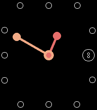
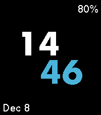

<!-- Generated by scripts/update_app_directory.py: do not edit by hand -->
[← All Pebble Developers](../developers.md)

# sjmerel

*3 watchfaces · Last updated 2026-10-11 · [About these lists](../about-app-lists.md)*

Links: [Pebble App Store](https://apps.repebble.com/apps/dev/sjmerel_c3cfdea00bafd8896a186e03) · [GitHub (sjmerel)](https://github.com/sjmerel)

<button type="button" data-filter="all" aria-pressed="true">All 3</button><button type="button" data-filter="watchface" aria-pressed="false">Watchfaces 3</button><button type="button" data-filter="watchapp" aria-pressed="false" disabled>Apps 0</button>

<label class="dev-sort">Sort by <select><option value="updated">Recently updated</option><option value="released">Newest release</option><option value="title">A–Z</option></select></label>

<h2 class="app-name" id="app-82f82f04a6434f4bbcfdc178"><a href="https://apps.repebble.com/82f82f04a6434f4bbcfdc178">Piet</a> v1.1</h2>
<a class="app-source" href="https://github.com/sjmerel/piet" title="Source code" data-search-exclude>View source</a>

Watchface

Released 2025-12-09 Updated 2025-12-09

Runs on: Time 2, Pebble 2 Duo, Pebble 2, Time, Classic

A Mondrian-inspired watchface. Give your wrist a quick twist to show the date and battery level. A bluetooth icon is displayed when disconnected.

<h2 class="app-name" id="app-09ceb96d8a6f4d13a84ce1e8"><a href="https://apps.repebble.com/09ceb96d8a6f4d13a84ce1e8">Dot</a> v1.0</h2>
<a class="app-source" href="https://github.com/sjmerel/dot" title="Source code" data-search-exclude>View source</a>

Watchface

Released 2025-12-08 Updated 2025-12-08

Runs on: Round 2, Time 2, Pebble 2 Duo, Pebble 2, Time Round, Time, Classic

Analog watchface, with... dots.

<h2 class="app-name" id="app-8c24105f15544c5987dfa240"><a href="https://apps.repebble.com/8c24105f15544c5987dfa240">Big</a> v1.1</h2>
<a class="app-source" href="https://github.com/sjmerel/big" title="Source code" data-search-exclude>View source</a>

Watchface

Released 2025-12-08 Updated 2025-12-08

Runs on: Round 2, Time 2, Pebble 2 Duo, Pebble 2, Time Round, Time, Classic

Simple watchface with big numbers for people with old eyes. Give your wrist a quick twist to show the date. The battery level will appear when charging, or when the level is 30% or less.

