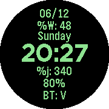

<!-- Generated by scripts/update_app_directory.py: do not edit by hand -->
[← All Pebble Developers](../developers.md)

# skeldoy

*1 watchface · Last updated 2026-10-12 · [About these lists](../about-app-lists.md)*

Links: [Pebble App Store](https://apps.repebble.com/apps/dev/skeldoy_56602fcb0ea7f7d852000023) · [GitHub (skeldoy)](https://github.com/skeldoy)

<h2 class="app-name" id="app-56648db89be95ea6d5000069"><a href="https://apps.repebble.com/56648db89be95ea6d5000069">MyFace</a> v1.4</h2>
<a class="app-source" href="https://github.com/skeldoy/myFace" title="Source code" data-search-exclude>View source</a>

Watchface

Released 2015-12-06 Updated 2015-12-09

Runs on: Round 2, Time Round

Old-school Hercules-graphics terminal style watchface. Gives you date, week number, day, time (sans seconds), day of the year, battery stats and bluetooth connectivity stat.

