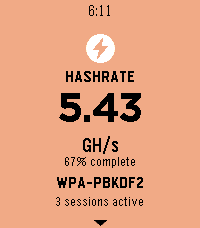

<!-- Generated by scripts/update_app_directory.py: do not edit by hand -->
[← All Pebble Developers](../developers.md)

# sky

*1 app · Last updated 2026-10-11 · [About these lists](../about-app-lists.md)*

Links: [Pebble App Store](https://apps.repebble.com/apps/dev/sky_222ff63e11389faf5d8c4e40) · [GitHub (jjsvs)](https://github.com/jjsvs)

<h2 class="app-name" id="app-9b341cf2753d4ae1a0a359ed"><a href="https://apps.repebble.com/9b341cf2753d4ae1a0a359ed">Hashcat Reactor</a> v1.0.1</h2>
<a class="app-source" href="https://github.com/jjsvs/Hashcat-Reactor" title="Source code" data-search-exclude>View source</a>

App

Released 2026-06-08 Updated 2026-06-13

Runs on: Round 2, Time 2, Pebble 2 Duo, Pebble 2, Time Round, Time, Classic

Dashboard for Hashcat-Reactor

