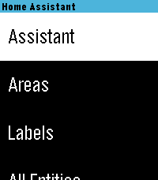

<!-- Generated by scripts/update_app_directory.py: do not edit by hand -->
[← All Pebble Developers](../developers.md)

# Skylar Sadlier

*1 watchface and 2 apps · Last updated 2026-10-11 · [About these lists](../about-app-lists.md)*

Links: [Pebble App Store](https://apps.repebble.com/apps/dev/skylar-sadlier_5d01f46b419d5a0001a47cfb) · [GitHub (skylord123)](https://github.com/skylord123) · [Website (skylar.tech)](https://skylar.tech)

<button type="button" data-filter="all" aria-pressed="true">All 3</button><button type="button" data-filter="watchface" aria-pressed="false">Watchfaces 1</button><button type="button" data-filter="watchapp" aria-pressed="false">Apps 2</button>

<label class="dev-sort">Sort by <select><option value="updated">Recently updated</option><option value="released">Newest release</option><option value="title">A–Z</option></select></label>

<h2 class="app-name" id="app-69386de69aa93e0009ba0011"><a href="https://apps.repebble.com/69386de69aa93e0009ba0011">ForeCal Reloaded (Weather Forecast &amp; Calendar)</a> v6.1</h2>
<a class="app-source" href="https://github.com/skylord123/ForeCal" title="Source code" data-search-exclude>View source</a>

Watchface · <a href="https://forum.rebble.io/t/195" title="Discuss this app on the Rebble forum" data-search-exclude>Forum thread</a>

Released 2025-12-09 Updated 2026-08-30

Runs on: Round 2, Time 2, Pebble 2 Duo, Pebble 2, Time Round, Time, Classic

ForeCal Reloaded is a modern update of the original ForeCal watchface by SeaPea, rebuilt for today’s Pebble and Rebble ecosystem. It keeps the clean, glanceable design while fixing long-standing…

<h2 class="app-name" id="app-68dea5734be9cb0009429595"><a href="https://apps.repebble.com/68dea5734be9cb0009429595">Home Assistant WS</a> v3.0</h2>
<a class="app-source" href="https://github.com/skylord123/pebble-home-assistant-ws" title="Source code" data-search-exclude>View source</a>

App · <a href="https://forum.rebble.io/t/96" title="Discuss this app on the Rebble forum" data-search-exclude>Forum thread</a>

Released 2025-10-02 Updated 2026-08-29

Runs on: Round 2, Time 2, Pebble 2 Duo, Pebble 2, Time Round, Time, Classic

Home Assistant control with real-time updates, voice commands, entity history, calendars, and support for a wide range of devices and helpers. Control your Home Assistant smart home directly from…

<h2 class="app-name" id="app-6975a845ae32660009f7c254"><a href="https://apps.repebble.com/6975a845ae32660009f7c254">Multi Weather</a> v1.2</h2>
<a class="app-source" href="https://github.com/skylord123/pebble-multi-weather" title="Source code" data-search-exclude>View source</a>

App · <a href="https://forum.rebble.io/t/568" title="Discuss this app on the Rebble forum" data-search-exclude>Forum thread</a>

Released 2026-01-25 Updated 2026-02-04

Runs on: Round 2, Time 2, Pebble 2 Duo, Pebble 2, Time Round, Time

Multi Weather is a Pebble smartwatch app that lets you view weather information from multiple weather providers in one place. Quickly check current conditions, daily high and low temperatures, and…

