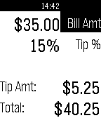

<!-- Generated by scripts/update_app_directory.py: do not edit by hand -->
[← All Pebble Developers](../developers.md)

# SlideWave, LLC

*1 app · Last updated 2026-10-11 · [About these lists](../about-app-lists.md)*

Links: [Pebble App Store](https://apps.repebble.com/apps/dev/slidewave-llc_530792b655bea2f4f80000d2) · [GitHub (ddaeschler)](https://github.com/ddaeschler) · [Website (daviddaeschler.com)](http://daviddaeschler.com)

<h2 class="app-name" id="app-53090bbfab1ae26bc70005e3"><a href="https://apps.repebble.com/53090bbfab1ae26bc70005e3">Tip Calculator</a> v1.5.0</h2>
<a class="app-source" href="https://github.com/ddaeschler/pebble-tipcalc" title="Source code" data-search-exclude>View source</a>

App

Released 2014-02-22 Updated 2014-03-09

Runs on: Time 2, Pebble 2 Duo, Pebble 2, Time, Classic

Enter the check amount and set a tip percentage and this app will calculate the tip amount and bill total

