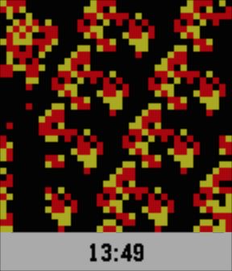

<!-- Generated by scripts/update_app_directory.py: do not edit by hand -->
[← All Pebble Developers](../developers.md)

# slightair

*1 watchface · Last updated 2026-10-11 · [About these lists](../about-app-lists.md)*

Links: [Pebble App Store](https://apps.repebble.com/apps/dev/slightair_545b71f53ee6124b3b000059) · [GitHub (slightair)](https://github.com/slightair)

<h2 class="app-name" id="app-54703ce10ad7b44334000049"><a href="https://apps.repebble.com/54703ce10ad7b44334000049">CA2D</a> v2.1</h2>
<a class="app-source" href="https://github.com/slightair/Pebble-CA2D" title="Source code" data-search-exclude>View source</a>

Watchface

Released 2014-11-22 Updated 2015-06-28

Runs on: Time 2, Pebble 2 Duo, Pebble 2, Time, Classic

Display multi state 2D Cellular Automata animation(345/2/4, star wars rule).

