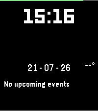

<!-- Generated by scripts/update_app_directory.py: do not edit by hand -->
[← All Pebble Developers](../developers.md)

# slopvibe.org

*2 watchfaces · Last updated 2026-10-11 · [About these lists](../about-app-lists.md)*

Links: [Pebble App Store](https://apps.repebble.com/apps/dev/slopvibe-org_cfadaf596b28e057a24400e3) · [GitHub (SlopVibe-org)](https://github.com/SlopVibe-org) · [Website (slopvibe.org)](https://slopvibe.org)

<button type="button" data-filter="all" aria-pressed="true">All 2</button><button type="button" data-filter="watchface" aria-pressed="false">Watchfaces 2</button><button type="button" data-filter="watchapp" aria-pressed="false" disabled>Apps 0</button>

<label class="dev-sort">Sort by <select><option value="updated">Recently updated</option><option value="released">Newest release</option><option value="title">A–Z</option></select></label>

<h2 class="app-name" id="app-f62530e9f97649b093a50e9e"><a href="https://apps.repebble.com/f62530e9f97649b093a50e9e">Timely-Vibe</a> v3.3.1</h2>
<a class="app-source" href="https://github.com/SlopVibe-org/timely-vibe" title="Source code" data-search-exclude>View source</a>

Watchface

GPL-3.0 Released 2026-07-22 Updated 2026-07-22

Runs on: Time 2

Calendar watchface based on TimelyNG. Features: 3-week calendar view, configurable complication rows, weather, and custom iCal calendar feed support (Google, Apple, Nextcloud, any .ics URL)…

<h2 class="app-name" id="app-b5328a75079a439ab6da2c46"><a href="https://apps.repebble.com/b5328a75079a439ab6da2c46">SlopVibe</a> v1.9.0</h2>
<a class="app-source" href="https://github.com/SlopVibe-org/pebble-watchfaces" title="Source code" data-search-exclude>View source</a>

Watchface

No licence Released 2026-07-22 Updated 2026-07-22

Runs on: Time 2

SlopVibe watchface with weather, configurable iCal calendar, steps, and battery. Open-Meteo weather, custom iCal URL support (Google, Apple, Nextcloud, any .ics).

