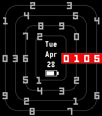

<!-- Generated by scripts/update_app_directory.py: do not edit by hand -->
[← All Pebble Developers](../developers.md)

# Sloth8497

*5 watchfaces · Last updated 2026-10-11 · [About these lists](../about-app-lists.md)*

Links: [Pebble App Store](https://apps.repebble.com/apps/dev/sloth8497_68c4a750647ef000080f0b2d) · [GitHub (ping840907)](https://github.com/ping840907)

<button type="button" data-filter="all" aria-pressed="true">All 5</button><button type="button" data-filter="watchface" aria-pressed="false">Watchfaces 5</button><button type="button" data-filter="watchapp" aria-pressed="false" disabled>Apps 0</button>

<label class="dev-sort">Sort by <select><option value="updated">Recently updated</option><option value="released">Newest release</option><option value="title">A–Z</option></select></label>

<h2 class="app-name" id="app-0fe5ed7ed11f4ccc8cb53216"><a href="https://apps.repebble.com/0fe5ed7ed11f4ccc8cb53216">Locus</a> v1.0.4</h2>
<a class="app-source" href="https://github.com/ping840907/Locus" title="Source code" data-search-exclude>View source</a>

Watchface · <a href="https://forum.rebble.io/t/1046" title="Discuss this app on the Rebble forum" data-search-exclude>Forum thread</a>

Released 2026-06-11 Updated 2026-08-31

Runs on: Round 2, Time 2, Pebble 2 Duo, Pebble 2, Time Round, Time, Classic

Locus turns your smartwatch into a live map. Inspired by the beautiful Places watchface from the Looks collection by ustwo, this app reimagines that brilliant concept specifically for Pebble. It…

<h2 class="app-name" id="app-54681ab6b6104c1ca42f6e31"><a href="https://apps.repebble.com/54681ab6b6104c1ca42f6e31">What Time?</a> v1.0.3</h2>
<a class="app-source" href="https://github.com/ping840907/what-time" title="Source code" data-search-exclude>View source</a>

Watchface · <a href="https://forum.rebble.io/t/974" title="Discuss this app on the Rebble forum" data-search-exclude>Forum thread</a>

Released 2026-05-14 Updated 2026-08-17

Runs on: Round 2, Time 2, Pebble 2 Duo, Pebble 2, Time Round, Time, Classic

What Time? — The Reluctant Watchface Why do you even need to know the time? This watchface is designed to ask exactly that. At first glance, it refuses to give you numbers. Instead, it greets your…

<h2 class="app-name" id="app-68ee48a13e917c00090b923c"><a href="https://apps.repebble.com/68ee48a13e917c00090b923c">zh-TW_Pixel</a> v2.0.2</h2>
<a class="app-source" href="https://github.com/ping840907/zh-TW_Pixel" title="Source code" data-search-exclude>View source</a>

Watchface · <a href="https://forum.rebble.io/t/401" title="Discuss this app on the Rebble forum" data-search-exclude>Forum thread</a>

Released 2025-10-14 Updated 2026-06-06

Runs on: Time 2, Pebble 2 Duo, Pebble 2, Time, Classic

A pixel-style pebble watch face with a full Chinese display, striking a balance between colloquialism and literary sense. In order to accommodate the Chinese way of reading time and the aesthetics…

<h2 class="app-name" id="app-64924ceaf0c34b4fbda7a8f9"><a href="https://apps.repebble.com/64924ceaf0c34b4fbda7a8f9">Continuum</a> v1.3.2</h2>
<a class="app-source" href="https://github.com/ping840907/Continuum" title="Source code" data-search-exclude>View source</a>

Watchface · <a href="https://forum.rebble.io/t/926" title="Discuss this app on the Rebble forum" data-search-exclude>Forum thread</a>

Released 2026-04-28 Updated 2026-05-15

Runs on: Round 2, Time 2, Pebble 2 Duo, Pebble 2, Time Round, Time, Classic

A watch face with smooth time-rotation animation and rich customizable functions.

<h2 class="app-name" id="app-3d0b528d14fd447792535689"><a href="https://apps.repebble.com/3d0b528d14fd447792535689">JapaneseKanjiWatchface</a> v1.0</h2>
<a class="app-source" href="https://github.com/ping840907/jpkanjiwatchface" title="Source code" data-search-exclude>View source</a>

Watchface

Released 2026-04-04 Updated 2026-04-04

Runs on: Time 2, Pebble 2 Duo, Pebble 2, Time, Classic

A watch face that uses pixelated Japanese kanji to display the time and date, similar to my previous work, but with localized design.

