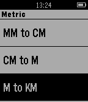
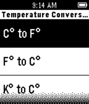

<!-- Generated by scripts/update_app_directory.py: do not edit by hand -->
[← All Pebble Developers](../developers.md)

# small rock design labs!

*4 apps · Last updated 2026-10-11 · [About these lists](../about-app-lists.md)*

Links: [Pebble App Store](https://apps.repebble.com/apps/dev/small-rock-design-labs_54c3a91ca64480370e000062)

<button type="button" data-filter="all" aria-pressed="true">All 4</button><button type="button" data-filter="watchface" aria-pressed="false" disabled>Watchfaces 0</button><button type="button" data-filter="watchapp" aria-pressed="false">Apps 4</button>

<label class="dev-sort">Sort by <select><option value="updated">Recently updated</option><option value="released">Newest release</option><option value="title">A–Z</option></select></label>

<h2 class="app-name" id="app-56a8d5e70b9e953a7100002a"><a href="https://apps.repebble.com/56a8d5e70b9e953a7100002a">Cookie Clickers Color</a> v3.1</h2>
<a class="app-source" href="http://bit.ly/aboutpdl" title="Source code" data-search-exclude>View source</a>

App

Released 2016-01-27 Updated 2016-01-27

Runs on: Time 2, Pebble 2 Duo, Pebble 2, Time, Classic

Color version of the Cookie Clickers B/W

<h2 class="app-name" id="app-55217260e1e3d5551000004e"><a href="https://apps.repebble.com/55217260e1e3d5551000004e">Length Converter</a> v1.0</h2>
<a class="app-source" href="http://bit.ly/aboutpdl" title="Source code" data-search-exclude>View source</a>

App

Released 2015-04-05 Updated 2015-04-05

Runs on: Time 2, Pebble 2 Duo, Pebble 2, Time, Classic

About: http://bit.ly/aboutpdl ---------- This app tells you how to convert length from your wrist! Simply open the app, and then select your method of conversion ------- Donate…

<h2 class="app-name" id="app-54d0b0dd699bcefb4f000094"><a href="https://apps.repebble.com/54d0b0dd699bcefb4f000094">US States</a> v1.0</h2>
<a class="app-source" href="http://bit.ly/aboutpdl" title="Source code" data-search-exclude>View source</a>

App

Released 2015-02-03 Updated 2015-02-04

Runs on: Time 2, Pebble 2 Duo, Pebble 2, Time, Classic

About: http://bit.ly/aboutpdl ---------- This state app allows you to study the states from your wrist! Simply open the app choose the state to study. ------- Donate: http://bit.ly/statepay

<h2 class="app-name" id="app-54cf873e6d23f890220000a3"><a href="https://apps.repebble.com/54cf873e6d23f890220000a3">Temperature Converter</a> v0.4</h2>
<a class="app-source" href="http://bit.ly/aboutpdl" title="Source code" data-search-exclude>View source</a>

App

Released 2015-02-02 Updated 2015-02-02

Runs on: Time 2, Pebble 2 Duo, Pebble 2, Time, Classic

About: http://bit.ly/aboutpdl ---------- This converter app allows you to convert temperatures from your wrist! Simply open the app and method to convert. ------- Donate: http://bit.ly/temppay

