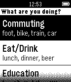

<!-- Generated by scripts/update_app_directory.py: do not edit by hand -->
[← All Pebble Developers](../developers.md)

# smartDAYS

*1 app · Last updated 2026-10-12 · [About these lists](../about-app-lists.md)*

Links: [Pebble App Store](https://apps.repebble.com/apps/dev/smartdays_52d9ae3cb82a9fd7d7000017) · [GitHub (itzkha)](https://github.com/itzkha) · [Website (dropbox.com)](https://www.dropbox.com/s/eudzspw3fy14xc8/protocol_consent.pdf?dl=0)

<h2 class="app-name" id="app-54f44fee89900eba28000041"><a href="https://apps.repebble.com/54f44fee89900eba28000041">SmartDAYS</a> v0.3</h2>
<a class="app-source" href="https://github.com/itzkha/pebble_code/" title="Source code" data-search-exclude>View source</a>

App

No licence Released 2015-03-02 Updated 2015-03-10

Runs on: Time 2, Pebble 2 Duo, Pebble 2, Time, Classic

Research application aiming to automatically detect and log daily activities from motion sensors onboard the Pebble watch. Note: This application is simply a data logging application for now…

