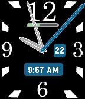
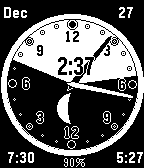

<!-- Generated by scripts/update_app_directory.py: do not edit by hand -->
[← All Pebble Developers](../developers.md)

# smognus

*2 watchfaces · Last updated 2026-10-12 · [About these lists](../about-app-lists.md)*

Links: [Pebble App Store](https://apps.repebble.com/apps/dev/smognus_52b50553d384d88d6200000b) · [GitHub (smognus)](https://github.com/smognus)

<button type="button" data-filter="all" aria-pressed="true">All 2</button><button type="button" data-filter="watchface" aria-pressed="false">Watchfaces 2</button><button type="button" data-filter="watchapp" aria-pressed="false" disabled>Apps 0</button>

<label class="dev-sort">Sort by <select><option value="updated">Recently updated</option><option value="released">Newest release</option><option value="title">A–Z</option></select></label>

<h2 class="app-name" id="app-5621a59ea97d31cb8000001b"><a href="https://apps.repebble.com/5621a59ea97d31cb8000001b">Variable Hands</a> v1.8</h2>
<a class="app-source" href="https://github.com/smognus/variable-hands-SDK3" title="Source code" data-search-exclude>View source</a>

Watchface

Released 2015-10-17 Updated 2015-10-22

Runs on: Time 2, Time

It has always bothered me that watch hands on a rectangular watchface are a varying distance from the edge of the face. This watchface grows and shrinks the hands dynamically so that they are…

<h2 class="app-name" id="app-52bdf615dc2f4f96d50000d6"><a href="https://apps.repebble.com/52bdf615dc2f4f96d50000d6">Sunset Watch</a> v1.0.0</h2>
<a class="app-source" href="http://github.com/smognus/sunset-watch" title="Source code" data-search-exclude>View source</a>

Watchface

No licence Released 2013-12-27 Updated 2013-12-27

Runs on: Time 2, Pebble 2 Duo, Pebble 2, Time, Classic

This is the Sunset Watch. On launch, the watchface will automatically ask for your location from your phone. Once it knows where you are, it will determine the local sunrise/sunset times and phase…

