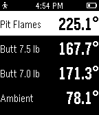

<!-- Generated by scripts/update_app_directory.py: do not edit by hand -->
[← All Pebble Developers](../developers.md)

# Smokin&\#x27; Hardware, Inc.

*1 app · Last updated 2026-10-11 · [About these lists](../about-app-lists.md)*

Links: [Pebble App Store](https://apps.repebble.com/apps/dev/smokin-hardware-inc_54b16e06d461428721000098) · [GitHub (CapnBry)](https://github.com/CapnBry) · [Website (store.heatermeter.com)](http://store.heatermeter.com/)

<h2 class="app-name" id="app-55259ffe06e80c1580000063"><a href="https://apps.repebble.com/55259ffe06e80c1580000063">HeaterMeter</a> v1.0</h2>
<a class="app-source" href="https://github.com/CapnBry/HeaterMeter" title="Source code" data-search-exclude>View source</a>

App

MIT Released 2015-04-08 Updated 2015-04-08

Runs on: Time 2, Pebble 2 Duo, Pebble 2, Time, Classic

Keep track of your barbecue and control it without having someone fish around in your pocket for your phone. This Pebble app interfaces with a HeaterMeter BBQ controller through your smartphone to…

