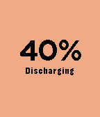

<!-- Generated by scripts/update_app_directory.py: do not edit by hand -->
[← All Pebble Developers](../developers.md)

# Snilius

*1 app · Last updated 2026-10-11 · [About these lists](../about-app-lists.md)*

Links: [Pebble App Store](https://apps.repebble.com/apps/dev/snilius_52b1eda4c7543f79c300002a) · [GitHub (victorhaggqvist)](https://github.com/victorhaggqvist)

<h2 class="app-name" id="app-52e1a139e819d83fcf000012"><a href="https://apps.repebble.com/52e1a139e819d83fcf000012">Battery Monitor</a> v1.5</h2>
<a class="app-source" href="https://github.com/victorhaggqvist/pebble-battery-monitor" title="Source code" data-search-exclude>View source</a>

App

Released 2014-01-23 Updated 2015-11-21

Runs on: Round 2, Time 2, Pebble 2 Duo, Pebble 2, Time Round, Time, Classic

A simple battery monitor Hint: You can toggle the text with the middle button

