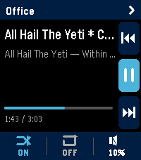

<!-- Generated by scripts/update_app_directory.py: do not edit by hand -->
[← All Pebble Developers](../developers.md)

# snoe

*1 app · Last updated 2026-10-11 · [About these lists](../about-app-lists.md)*

Links: [Pebble App Store](https://apps.repebble.com/apps/dev/snoe_444b0aa9d8662f61e4b53b34) · [GitHub (s256)](https://github.com/s256)

<h2 class="app-name" id="app-4274579b352a4e609de34d48"><a href="https://apps.repebble.com/4274579b352a4e609de34d48">Music Assistant Control</a> v1.2.1</h2>
<a class="app-source" href="https://github.com/s256/pebble-musicassistant-remote/" title="Source code" data-search-exclude>View source</a>

App

Released 2026-06-22 Updated 2026-06-22

Runs on: Time 2

Music Assistant Remote turns your Pebble Time 2 into a proper remote for your Music Assistant server. Transport, volume, multi-room grouping, and one-tap shortcuts to your library — all from your…

