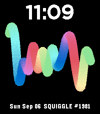

<!-- Generated by scripts/update_app_directory.py: do not edit by hand -->
[← All Pebble Developers](../developers.md)

# Snowfro

*1 watchface · Last updated 2026-10-12 · [About these lists](../about-app-lists.md)*

Links: [Pebble App Store](https://apps.repebble.com/apps/dev/snowfro_8471bf808a9de205c4d65033)

<h2 class="app-name" id="app-f977e71e8caa4243804ca4e0"><a href="https://apps.repebble.com/f977e71e8caa4243804ca4e0">Squiggles</a> v0.7.1</h2>
<a class="app-source" href="https://snowfro.com" title="Source code" data-search-exclude>View source</a>

Watchface

Released 2026-09-06 Updated 2026-09-11

Runs on: Time 2

Procedurally render any of the 10,000 Chromie Squiggles directly on Pebble Time 2. Choose one, explore All Squiggles as a random slideshow filtered by type, build a Custom Playlist, or follow the…

