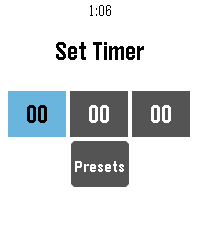

<!-- Generated by scripts/update_app_directory.py: do not edit by hand -->
[← All Pebble Developers](../developers.md)

# snrkl labs

*3 apps · Last updated 2026-10-12 · [About these lists](../about-app-lists.md)*

Links: [Pebble App Store](https://apps.repebble.com/apps/dev/snrkl-labs_4aece47c3cbfb14d594e6f1b) · [GitHub (snrkl-labs)](https://github.com/snrkl-labs)

<button type="button" data-filter="all" aria-pressed="true">All 3</button><button type="button" data-filter="watchface" aria-pressed="false" disabled>Watchfaces 0</button><button type="button" data-filter="watchapp" aria-pressed="false">Apps 3</button>

<label class="dev-sort">Sort by <select><option value="updated">Recently updated</option><option value="released">Newest release</option><option value="title">A–Z</option></select></label>

<h2 class="app-name" id="app-07574105fbd2472e9055b82d"><a href="https://apps.repebble.com/07574105fbd2472e9055b82d">Alarm Rock</a> v0.6.4</h2>
<a class="app-source" href="https://github.com/snrkl-labs/AlarmRock" title="Source code" data-search-exclude>View source</a>

App

Released 2026-07-03 Updated 2026-08-18

Runs on: Round 2, Time 2, Pebble 2 Duo, Pebble 2, Time Round, Time, Classic

I was tired of not having a seamless integration between alarms and smart watches on Android. I discovered that unless you had a phone and watch of a matching brand, it seems alarms were either…

<h2 class="app-name" id="app-b2b9a975d9ab466f98cb4a2d"><a href="https://apps.repebble.com/b2b9a975d9ab466f98cb4a2d">Big Rock Battery</a> v1.4.0</h2>
<a class="app-source" href="https://github.com/snrkl-labs/BigRockBattery" title="Source code" data-search-exclude>View source</a>

App

Released 2026-07-04 Updated 2026-08-14

Runs on: Round 2, Time 2, Pebble 2 Duo, Pebble 2, Time Round, Time, Classic

I can&#x27;t see any of the built in battery gauges on the default watch while wearing my glasses, let alone without them on. This solves that problem: A giant watch battery gauge that I can see from…

<h2 class="app-name" id="app-479c3ffae56a4529bdeafced"><a href="https://apps.repebble.com/479c3ffae56a4529bdeafced">Rock Timer</a> v0.11.0</h2>
<a class="app-source" href="https://github.com/snrkl-labs" title="Source code" data-search-exclude>View source</a>

App

Released 2026-07-02 Updated 2026-07-02

Runs on: Time 2, Pebble 2 Duo, Pebble 2

• Fork of the official Pebble timer app • Full touchscreen support — inertial drag-to-scroll, long-press / double-tap to select • Configurable timer presets, edited from your phone • Choose your…

