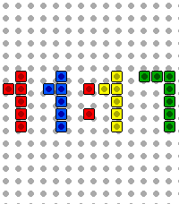

<!-- Generated by scripts/update_app_directory.py: do not edit by hand -->
[← All Pebble Developers](../developers.md)

# socrates.codes

*1 watchface · Last updated 2026-10-12 · [About these lists](../about-app-lists.md)*

Links: [Rebble App Store](https://apps.rebble.io/en_US/developer/6a36ac1f2eb225000893d148/1) · [GitHub (sandylewat)](https://github.com/sandylewat) · [Website (socrates.codes)](https://socrates.codes)

<h2 class="app-name" id="app-6a36ba8b884566000985aaf1"><a href="https://apps.rebble.io/en_US/application/6a36ba8b884566000985aaf1">Colored Bricks</a> v1.1.1</h2>
<a class="app-source" href="https://github.com/sandylewat/colored-bricks" title="Source code" data-search-exclude>View source</a>

Watchface · <a href="https://forum.rebble.io/t/1076" title="Discuss this app on the Rebble forum" data-search-exclude>Forum thread</a>

Released 2026-06-20 Updated 2026-06-27 Rebble App Store

Runs on: Time 2

A LEGO brick-inspired Pebble watchface for the Pebble Time 2 (emery). The time is displayed in a brick font, every digit is built from individual brick-style tiles.

