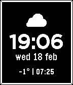

<!-- Generated by scripts/update_app_directory.py: do not edit by hand -->
[← All Pebble Developers](../developers.md)

# Sofus

*1 watchface · Last updated 2026-10-12 · [About these lists](../about-app-lists.md)*

Links: [Pebble App Store](https://apps.repebble.com/apps/dev/sofus_50bb0efeef00269340b2f246) · [GitHub (SofusA)](https://github.com/SofusA)

<h2 class="app-name" id="app-9494651f596145d78d5250dc"><a href="https://apps.repebble.com/9494651f596145d78d5250dc">Minimal Weather</a> v1.0</h2>
<a class="app-source" href="https://github.com/SofusA/minimal-weather" title="Source code" data-search-exclude>View source</a>

Watchface · <a href="https://forum.rebble.io/t/762" title="Discuss this app on the Rebble forum" data-search-exclude>Forum thread</a>

MIT Released 2026-02-18 Updated 2026-02-18

Runs on: Time 2, Time

Simple open source pebble watch face with weather data from YR.no. Features: - Battery warning icon when below 25% - UV index warning when index is above 3 - Rain warning when expected…

