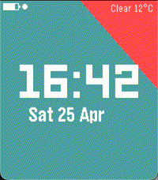

<!-- Generated by scripts/update_app_directory.py: do not edit by hand -->
[← All Pebble Developers](../developers.md)

# Sojocha

*1 watchface · Last updated 2026-10-12 · [About these lists](../about-app-lists.md)*

Links: [Pebble App Store](https://apps.repebble.com/apps/dev/sojocha_c6b53cf9ed177d02545ca110) · [GitHub (sbrueckl)](https://github.com/sbrueckl)

<h2 class="app-name" id="app-f5049ca6ebfd485aa8595b60"><a href="https://apps.repebble.com/f5049ca6ebfd485aa8595b60">Upcoming Calendar Cards</a> v1.4.0</h2>
<a class="app-source" href="https://github.com/sbrueckl/upcoming-calendar-cards" title="Source code" data-search-exclude>View source</a>

Watchface

Released 2026-04-17 Updated 2026-04-28

Runs on: Round 2, Time 2, Pebble 2 Duo, Pebble 2, Time Round, Time

The watchface shows digital time, the next upcoming Google Calendar event as a sliding card, live weather, date, battery, and Bluetooth status. This watchface was heavily inspired by Ester…

