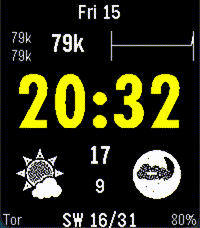

<!-- Generated by scripts/update_app_directory.py: do not edit by hand -->
[← All Pebble Developers](../developers.md)

# Solar Timekeeper

*1 watchface · Last updated 2026-10-11 · [About these lists](../about-app-lists.md)*

Links: [Pebble App Store](https://apps.repebble.com/apps/dev/solar-timekeeper_b2429c905b062035b8272e7e) · [GitHub (yodalf)](https://github.com/yodalf)

<h2 class="app-name" id="app-38d93227474b40f3aa2efa4f"><a href="https://apps.repebble.com/38d93227474b40f3aa2efa4f">Bitcoin and Weather</a> v5.2.3</h2>
<a class="app-source" href="https://github.com/yodalf/coincan" title="Source code" data-search-exclude>View source</a>

Watchface

Released 2026-05-15 Updated 2026-05-16

Runs on: Time 2, Pebble 2 Duo, Pebble 2, Time, Classic

Modern implementation of the original 10+ year old Coincan

