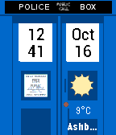

<!-- Generated by scripts/update_app_directory.py: do not edit by hand -->
[← All Pebble Developers](../developers.md)

# somepaddi

*1 watchface and 1 app · Last updated 2026-10-12 · [About these lists](../about-app-lists.md)*

Links: [Pebble App Store](https://apps.repebble.com/apps/dev/somepaddi_57daea402d0cc8673f0000dd) · [GitHub (gitpaddi)](https://github.com/gitpaddi)

<button type="button" data-filter="all" aria-pressed="true">All 2</button><button type="button" data-filter="watchface" aria-pressed="false">Watchfaces 1</button><button type="button" data-filter="watchapp" aria-pressed="false">Apps 1</button>

<label class="dev-sort">Sort by <select><option value="updated">Recently updated</option><option value="released">Newest release</option><option value="title">A–Z</option></select></label>

<h2 class="app-name" id="app-58038d5cc988665c140000c2"><a href="https://apps.repebble.com/58038d5cc988665c140000c2">Tardis BT Weather Watch</a> v1.0</h2>
<a class="app-source" href="https://github.com/gitpaddi/Tardis_BT_Weather" title="Source code" data-search-exclude>View source</a>

Watchface

No licence Released 2016-10-16 Updated 2016-10-16

Runs on: Time 2, Time

Tardis inspired WatchFace for Pebble. Features: - Time/Date - Vibration on BT connection loss - Weather information from openweathermap.org Time =&gt; upper left Date =&gt; upper right BT =&gt; left door…

<h2 class="app-name" id="app-58039d22c98866a9d80000f4"><a href="https://apps.repebble.com/58039d22c98866a9d80000f4">Color Browser</a> v1.0</h2>
<a class="app-source" href="https://github.com/gitpaddi/PebbleAppColorBrowser" title="Source code" data-search-exclude>View source</a>

App

No licence Released 2016-10-16 Updated 2016-10-16

Runs on: Time 2, Time

This app shows you colors with their hex codes and an example how that color looks on the Pebble Time.

