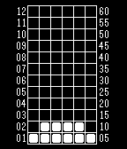

<!-- Generated by scripts/update_app_directory.py: do not edit by hand -->
[← All Pebble Developers](../developers.md)

# Sonny\_Jim

*1 watchface · Last updated 2026-10-12 · [About these lists](../about-app-lists.md)*

Links: [Rebble App Store](https://apps.rebble.io/en_US/developer/58458092ca3094c66f000772/1) · [GitHub (SonnyJim)](https://github.com/SonnyJim)

<h2 class="app-name" id="app-5850abcfce45dc224e00002f"><a href="https://apps.rebble.io/en_US/application/5850abcfce45dc224e00002f">Pimpin Ain&#x27;t Easy</a> v1.0</h2>
<a class="app-source" href="https://github.com/SonnyJim/PebblePimp" title="Source code" data-search-exclude>View source</a>

Watchface

No licence Released 2016-12-14 Updated 2016-12-14 Rebble App Store

Runs on: Time 2, Pebble 2 Duo, Pebble 2, Time, Classic

Watchface based on the Tokyoflash &quot;Pimpin Aint Easy&quot; watch. Shake to switch between time and date. Instructions on how to read the watchface here: http://www.tokyoflash.com/pages/000019/000019.pdf

