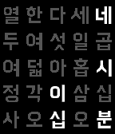
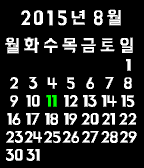
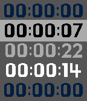

<!-- Generated by scripts/update_app_directory.py: do not edit by hand -->
[← All Pebble Developers](../developers.md)

# Soomtong

*1 watchface and 2 apps · Last updated 2026-10-12 · [About these lists](../about-app-lists.md)*

Links: [Pebble App Store](https://apps.repebble.com/apps/dev/soomtong_552d1af58215a22dc100000e) · [GitHub (soomtong)](https://github.com/soomtong)

<button type="button" data-filter="all" aria-pressed="true">All 3</button><button type="button" data-filter="watchface" aria-pressed="false">Watchfaces 1</button><button type="button" data-filter="watchapp" aria-pressed="false">Apps 2</button>

<label class="dev-sort">Sort by <select><option value="updated">Recently updated</option><option value="released">Newest release</option><option value="title">A–Z</option></select></label>

<h2 class="app-name" id="app-5598b2766e86ef1b190000cd"><a href="https://apps.repebble.com/5598b2766e86ef1b190000cd">HannaClock</a> v2.3</h2>
<a class="app-source" href="https://github.com/soomtong/HannaClock" title="Source code" data-search-exclude>View source</a>

Watchface

Released 2015-07-05 Updated 2015-12-26

Runs on: Round 2, Time 2, Pebble 2 Duo, Pebble 2, Time Round, Time, Classic

Simple Watchface using Hanna font for Pebble Time - Update Screen Every 5 min Original Designed by @suapapa Hanna Font Created &amp; Published by Woowahan.com

<h2 class="app-name" id="app-559f949e93ff77bebd000013"><a href="https://apps.repebble.com/559f949e93ff77bebd000013">HannaCalendar</a> v2.0</h2>
<a class="app-source" href="https://github.com/soomtong/HannaCalendar" title="Source code" data-search-exclude>View source</a>

App

Released 2015-07-10 Updated 2015-12-25

Runs on: Round 2, Time 2, Pebble 2 Duo, Pebble 2, Time Round, Time, Classic

Simple Watch-app using Hanna font for Pebble Time - Up and Down button for change Calendar - Select button for this month

<h2 class="app-name" id="app-55b34b29deeaa3c469000035"><a href="https://apps.repebble.com/55b34b29deeaa3c469000035">HannaTimer</a> v2.3</h2>
<a class="app-source" href="https://github.com/soomtong/HannaTimer" title="Source code" data-search-exclude>View source</a>

App

Released 2015-07-25 Updated 2015-08-13

Runs on: Time 2, Time

# HannaTimer simple stopwatch for time-flow event. this app has two mode, that remember previous mode. change mode `long up click` action. ## LAP TIMER - time with interval(gap) each stopwatch…

