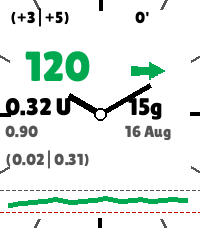

<!-- Generated by scripts/update_app_directory.py: do not edit by hand -->
[← All Pebble Developers](../developers.md)

# Soopaloop

*1 watchface · Last updated 2026-10-11 · [About these lists](../about-app-lists.md)*

Links: [Pebble App Store](https://apps.repebble.com/apps/dev/soopaloop_5f77fb329ed47a89ea649fff) · [GitHub (ssuppe)](https://github.com/ssuppe)

<h2 class="app-name" id="app-a5f73770a25f46d5a4b9a090"><a href="https://apps.repebble.com/a5f73770a25f46d5a4b9a090">PebbleAAPS</a> v1.0.0</h2>
<a class="app-source" href="https://github.com/ssuppe/PebbleAAPS" title="Source code" data-search-exclude>View source</a>

Watchface

Released 2026-08-16 Updated 2026-08-16

Runs on: Round 2, Time 2, Pebble 2 Duo, Pebble 2, Time Round, Time

PebbleAAPS is a lightweight, high-contrast Pebble watchface that displays real-time status data broadcast from AndroidAPS (AAPS), including glucose readings, trend arrows, active insulin/carbs…

