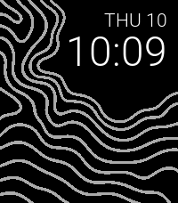
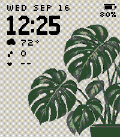

<!-- Generated by scripts/update_app_directory.py: do not edit by hand -->
[← All Pebble Developers](../developers.md)

# Sopko

*2 watchfaces · Last updated 2026-10-12 · [About these lists](../about-app-lists.md)*

Links: [Pebble App Store](https://apps.repebble.com/apps/dev/sopko_3c81137d9a285d2e9407ccdb) · [GitHub (sopko)](https://github.com/sopko)

<button type="button" data-filter="all" aria-pressed="true">All 2</button><button type="button" data-filter="watchface" aria-pressed="false">Watchfaces 2</button><button type="button" data-filter="watchapp" aria-pressed="false" disabled>Apps 0</button>

<label class="dev-sort">Sort by <select><option value="updated">Recently updated</option><option value="released">Newest release</option><option value="title">A–Z</option></select></label>

<h2 class="app-name" id="app-469cffc8c6e14cdf8f292055"><a href="https://apps.repebble.com/469cffc8c6e14cdf8f292055">Topographic</a> v1.2</h2>
<a class="app-source" href="https://github.com/sopko/topographic-pebble" title="Source code" data-search-exclude>View source</a>

Watchface

Released 2026-09-10 Updated 2026-09-21

Runs on: Time 2

Topographic pairs an uncluttered digital clock with flowing contour lines inspired by hillside maps. The landscape naturally frames the time, keeping it easy to read while giving the face a…

<h2 class="app-name" id="app-8990b26e518841329f7ced41"><a href="https://apps.repebble.com/8990b26e518841329f7ced41">Monstera</a> v1.4</h2>
<a class="app-source" href="https://github.com/sopko/monstera-watchface" title="Source code" data-search-exclude>View source</a>

Watchface

Released 2026-09-17 Updated 2026-09-18

Runs on: Time 2

A botanical watchface for the Pebble Time 2, pairing bold pixel numerals with forest-green monstera leaves and a muted gray-ivory background. - Live time using the watch&#x27;s 12/24-hour preference…

