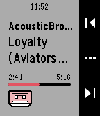

<!-- Generated by scripts/update_app_directory.py: do not edit by hand -->
[← All Pebble Developers](../developers.md)

# Sorunome

*1 app · Last updated 2026-10-11 · [About these lists](../about-app-lists.md)*

Links: [Pebble App Store](https://apps.repebble.com/apps/dev/sorunome_57f546304529f55dd7000029) · [GitHub (Sorunome)](https://github.com/Sorunome)

<h2 class="app-name" id="app-57ff60cf2cde651f0300020d"><a href="https://apps.repebble.com/57ff60cf2cde651f0300020d">MPD Client</a> v1.1</h2>
<a class="app-source" href="https://github.com/Sorunome/pebble-mpd-client" title="Source code" data-search-exclude>View source</a>

App

No licence Released 2016-10-13 Updated 2016-11-20

Runs on: Round 2, Time 2, Pebble 2 Duo, Pebble 2, Time Round, Time, Classic

Be able to control your MPD servers right from your smartwatch! Be sure to check out the installation guide over here, you might need to install a proxy server…

