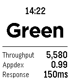

<!-- Generated by scripts/update_app_directory.py: do not edit by hand -->
[← All Pebble Developers](../developers.md)

# Soutaro Matsumoto

*1 watchface · Last updated 2026-10-12 · [About these lists](../about-app-lists.md)*

Links: [Pebble App Store](https://apps.repebble.com/apps/dev/soutaro-matsumoto_5444ae052a5191123d000056) · [GitHub (soutaro)](https://github.com/soutaro)

<h2 class="app-name" id="app-54703777762f64feae000039"><a href="https://apps.repebble.com/54703777762f64feae000039">Magellan Server Monitoring</a> v1.1</h2>
<a class="app-source" href="https://github.com/soutaro/magellan" title="Source code" data-search-exclude>View source</a>

Watchface

Released 2014-11-22 Updated 2014-11-30

Runs on: Time 2, Pebble 2 Duo, Pebble 2, Time, Classic

This Watchface helps you to keep monitoring your web app&#x27;s status through New Relic API.

