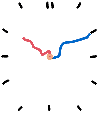
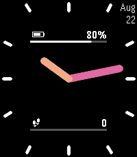

<!-- Generated by scripts/update_app_directory.py: do not edit by hand -->
[← All Pebble Developers](../developers.md)

# soxfox42

*3 watchfaces · Last updated 2026-10-12 · [About these lists](../about-app-lists.md)*

Links: [Pebble App Store](https://apps.repebble.com/apps/dev/soxfox42_67de4c3289abe700095df699) · [GitHub (soxfox42)](https://github.com/soxfox42) · [Website (soxfox.me)](https://soxfox.me/)

<button type="button" data-filter="all" aria-pressed="true">All 3</button><button type="button" data-filter="watchface" aria-pressed="false">Watchfaces 3</button><button type="button" data-filter="watchapp" aria-pressed="false" disabled>Apps 0</button>

<label class="dev-sort">Sort by <select><option value="updated">Recently updated</option><option value="released">Newest release</option><option value="title">A–Z</option></select></label>

<h2 class="app-name" id="app-9b9126db9e4343b08773fa76"><a href="https://apps.repebble.com/9b9126db9e4343b08773fa76">Marker</a> v1.0</h2>
<a class="app-source" href="https://github.com/soxfox42/pebble-marker/" title="Source code" data-search-exclude>View source</a>

Watchface

Released 2026-04-13 Updated 2026-04-13

Runs on: Round 2, Time 2, Pebble 2 Duo, Pebble 2, Time Round, Time, Classic

An analog clock that looks as though someone scribbled it on a whiteboard, featuring a short animation every time it changes!

<h2 class="app-name" id="app-37e3e88845ae4ea2a6625d25"><a href="https://apps.repebble.com/37e3e88845ae4ea2a6625d25">Shine Through</a> v1.3</h2>
<a class="app-source" href="https://github.com/soxfox42/shine-through" title="Source code" data-search-exclude>View source</a>

Watchface · <a href="https://forum.rebble.io/t/86" title="Discuss this app on the Rebble forum" data-search-exclude>Forum thread</a>

Released 2025-11-29 Updated 2026-03-10

Runs on: Round 2, Time 2, Pebble 2 Duo, Pebble 2, Time Round, Time, Classic

Large digits with a neat overlap effect between the hours and minutes. Configurable colors, and options to display date, steps, or battery in the corners.

<h2 class="app-name" id="app-68a7e04b8722670009a2381c"><a href="https://apps.repebble.com/68a7e04b8722670009a2381c">soxfox&#x27;s Face</a> v1.0</h2>
<a class="app-source" href="https://github.com/soxfox42/soxclock-pebble" title="Source code" data-search-exclude>View source</a>

Watchface

Released 2025-08-22 Updated 2025-08-22

Runs on: Round 2, Time 2, Pebble 2 Duo, Pebble 2, Time Round, Time, Classic

A simple analog watchface with meters for battery status and step tracking.

