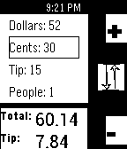

<!-- Generated by scripts/update_app_directory.py: do not edit by hand -->
[← All Pebble Developers](../developers.md)

# SpecificApps

*1 app · Last updated 2026-10-11 · [About these lists](../about-app-lists.md)*

Links: [Pebble App Store](https://apps.repebble.com/apps/dev/specificapps_52cc1f8ab138281492000161) · [GitHub (Med116)](https://github.com/Med116) · [Website (specificapps.com)](http://specificapps.com/app/31/)

<h2 class="app-name" id="app-5313eae14f9d0e8a15000557"><a href="https://apps.repebble.com/5313eae14f9d0e8a15000557">Tippy</a> v1.0.0</h2>
<a class="app-source" href="https://github.com/Med116/tippy" title="Source code" data-search-exclude>View source</a>

App

No licence Released 2014-03-03 Updated 2014-03-03

Runs on: Time 2, Pebble 2 Duo, Pebble 2, Time, Classic

Enter restaurant tip bill info into the watch, using the select button to toggle between &quot;dollars&quot;, &quot;cents&quot;, &quot;tip %&quot;, and &quot;people&quot;. The incrementer (up button) goes up by 5 every time you press…

