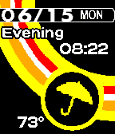
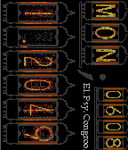
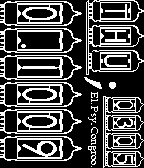

<!-- Generated by scripts/update_app_directory.py: do not edit by hand -->
[← All Pebble Developers](../developers.md)

# Spencer Johnson

*6 watchfaces · Last updated 2026-10-12 · [About these lists](../about-app-lists.md)*

Links: [Pebble App Store](https://apps.repebble.com/apps/dev/spencer-johnson_52ac665331a5fa7c25000006) · [Website (forums.getpebble.com)](http://forums.getpebble.com/discussion/5337/watch-face-sdk-2-0-ios-android-pebsona-4-golden)

<button type="button" data-filter="all" aria-pressed="true">All 6</button><button type="button" data-filter="watchface" aria-pressed="false">Watchfaces 6</button><button type="button" data-filter="watchapp" aria-pressed="false" disabled>Apps 0</button>

<label class="dev-sort">Sort by <select><option value="updated">Recently updated</option><option value="released">Newest release</option><option value="title">A–Z</option></select></label>

<h2 class="app-name" id="app-5570e001fbe0560f11000053"><a href="https://apps.repebble.com/5570e001fbe0560f11000053">Persona 4: ULTIMAX Ultra Suplex Hold</a> v4.1</h2>
<a class="app-source" href="https://Masamune_Shadow@bitbucket.org/Masamune_Shadow/pebsona-4-the-ultimax-ultra-suplex-hold.git" title="Source code" data-search-exclude>View source</a>

Watchface

Released 2015-06-04 Updated 2015-06-19

Runs on: Time 2, Time

Inspired by the HUD used in Persona 4, this watchface is a labor of love-style tribute that also provides real world functionality. Featuring: 12/24 hr time, hourly weather updates via geo…

<h2 class="app-name" id="app-5582347e9e9090eb82000047"><a href="https://apps.repebble.com/5582347e9e9090eb82000047">Teddie Time</a> v1.1</h2>
<a class="app-source" href="https://bitbucket.org/Masamune_Shadow/teddiewatchface" title="Source code" data-search-exclude>View source</a>

Watchface

Released 2015-06-18 Updated 2015-06-18

Runs on: Time 2, Time

It&#x27;s a watchface starring Teddie from Persona 4. His picture and saying changes every hour, and is randomized. I hope you enjoy it and have a bear-ific day.

<h2 class="app-name" id="app-52ac89e219ff500f7000000d"><a href="https://apps.repebble.com/52ac89e219ff500f7000000d">Persona 4: THE GOLDEN</a> v3.3</h2>
<a class="app-source" href="https://bitbucket.org/Masamune_Shadow/pebsona-4-the-golden/src/12f6c04737b3?at=master" title="Source code" data-search-exclude>View source</a>

Watchface

Released 2013-12-14 Updated 2015-06-18

Runs on: Time 2, Pebble 2 Duo, Pebble 2, Time, Classic

Inspired by the HUD used in Persona 4, this watchface is a labor of love-style tribute that also provides real world functionality. Featuring: 12/24 hr time, hourly weather updates via geo…

<h2 class="app-name" id="app-557f67d73c562e18e7000097"><a href="https://apps.repebble.com/557f67d73c562e18e7000097">The Journalism Show</a> v1.0</h2>
<a class="app-source" href="https://bitbucket.org/Masamune_Shadow/geraldobeedogwatchface" title="Source code" data-search-exclude>View source</a>

Watchface

Released 2015-06-16 Updated 2015-06-16

Runs on: Time 2, Time

Pretty simple watchface, just tells the time. Features Geraldo Beedog from The Journalism Show (http://rockmelonsoda.com/tjs/) created by Topher Cantler (@Topherocious)

<h2 class="app-name" id="app-5570e025fbe056218a000060"><a href="https://apps.repebble.com/5570e025fbe056218a000060">Divergence;Clock</a> v3.0</h2>
<a class="app-source" href="https://Masamune_Shadow@bitbucket.org/Masamune_Shadow/steinsgatewatchface.git" title="Source code" data-search-exclude>View source</a>

Watchface

Released 2015-06-04 Updated 2015-06-09

Runs on: Time 2, Time

An evolution of my Sideways Watchface for 2.x, but this time Inspired by Steins;Gate &amp; Nixie Clocks.

<h2 class="app-name" id="app-52ba1f15ecdaae6996000010"><a href="https://apps.repebble.com/52ba1f15ecdaae6996000010">Sideways;Watchface</a> v2.0.7</h2>
<a class="app-source" href="https://bitbucket.org/Masamune_Shadow/sideways-watchface" title="Source code" data-search-exclude>View source</a>

Watchface

Released 2013-12-24 Updated 2014-01-24

Runs on: Time 2, Pebble 2 Duo, Pebble 2, Time, Classic

An evolution of my Sideways Watchface for 2.x, but this time Inspired by Steins;Gate &amp; Nixie Clocks.

