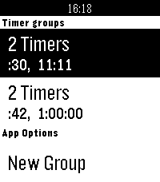

<!-- Generated by scripts/update_app_directory.py: do not edit by hand -->
[← All Pebble Developers](../developers.md)

# spencewenski

*1 app · Last updated 2026-10-11 · [About these lists](../about-app-lists.md)*

Links: [Rebble App Store](https://apps.rebble.io/en_US/developer/5836b499ca309464c9000130/1) · [GitLab (spencewenski)](https://gitlab.com/spencewenski) · [Website (spencewenski.com)](https://spencewenski.com/projects/grouped_timers/)

<h2 class="app-name" id="app-58f985730dfc329fda001649"><a href="https://apps.rebble.io/en_US/application/58f985730dfc329fda001649">Grouped Timers</a> v1.5</h2>
<a class="app-source" href="https://gitlab.com/spencewenski/pebble_grouped_timers" title="Source code" data-search-exclude>View source</a>

App

Released 2017-04-21 Updated 2018-03-17 Rebble App Store

Runs on: Round 2, Time 2, Pebble 2 Duo, Pebble 2, Time Round, Time

Now supports - French, Spanish, German, Italian, and Portuguese This is a timer app that allows you to group timers into lists. Timer groups can be set to automatically progress through the list…

