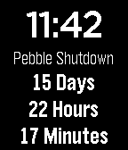

<!-- Generated by scripts/update_app_directory.py: do not edit by hand -->
[← All Pebble Developers](../developers.md)

# SphinxyScale

*1 watchface · Last updated 2026-10-11 · [About these lists](../about-app-lists.md)*

Links: [Rebble App Store](https://apps.rebble.io/en_US/developer/598af13e0dfc3275e2000b5a/1) · [GitHub (sensi277)](https://github.com/sensi277)

<h2 class="app-name" id="app-5b220db9f38588be6b001117"><a href="https://apps.rebble.io/en_US/application/5b220db9f38588be6b001117">Web Services Shutdown Countdown</a> v1.0</h2>
<a class="app-source" href="https://github.com/sensi277/pebbleWebServicesCountdown" title="Source code" data-search-exclude>View source</a>

Watchface

Released 2018-06-14 Updated 2018-06-14 Rebble App Store

Runs on: Time 2, Pebble 2 Duo, Pebble 2, Time, Classic

Counts down the amount of time to the Pebble Web Services shutdown. Based on https://github.com/kernel-sanders/Time-Until-Pebble

